# Mako Sync

Mako Sync is a metadata editor and syncing tool that helps music collectors bridge the gap between their Spotify library and local music collection. It finds the tracks you're missing, pushes them to slskd as searches so you can download them from Soulseek, and organizes files by Supergenre for DJ software.

## Who It's For

DJs and music collectors who want to:
- Identify gaps in their local music library compared to Spotify
- Organize tracks by Supergenre (24 DJ-friendly categories)
- Speed up the Spotify → slskd → local file workflow
- Maintain consistent genre tagging across their collection

## The 5-Step Workflow

```mermaid
flowchart TD
    subgraph step1["Step 1: Spotify Sync"]
        A[Connect Spotify Account] --> B[Sync Liked Songs]
        B --> C[Auto-map to Supergenres]
    end

    subgraph step2["Step 2: Local Files"]
        D[Select MP3 Folders] --> E[Scan & Extract Metadata]
        E --> F[Map to Supergenres]
    end

    subgraph step3["Step 3: No Genre Tracks"]
        G[Find Tracks Without Genre] --> H[AI Suggests Supergenre]
        H --> I[Accept / Reject / Manual]
    end

    subgraph step4["Step 4: Review Matches"]
        J[Compare Libraries] --> K[Review Suggested Matches]
        K --> K2[Confirm Missing Tracks]
        K2 --> L[Push to slskd as Searches]
    end

    subgraph step5["Step 5: Process Downloads"]
        M[Scan slskd Downloads] --> N[Map to Supergenres]
        N --> O[Write Tags to Files]
        O --> P[MediaMonkey Organizes]
    end

    C --> J
    F --> J
    I --> J
    L -.->|You download from slskd's Searches page| M

    style step1 fill:#1a365d,stroke:#3182ce
    style step2 fill:#1a365d,stroke:#3182ce
    style step3 fill:#1a365d,stroke:#3182ce
    style step4 fill:#1a365d,stroke:#3182ce
    style step5 fill:#1a365d,stroke:#3182ce
```

## Step Details

### Step 1: Spotify Sync
Connect your Spotify account and sync your liked songs. Each track is automatically mapped to one of 24 Supergenres based on Spotify's artist genre data.

**What you get:** A searchable, filterable list of your Spotify library with Supergenre assignments.

### Step 2: Local Files
Scan your local MP3 folders to extract metadata (artist, title, album, BPM, key). Files are matched against your Spotify library using normalized text comparison.

**What you get:** A catalog of your local collection ready for gap analysis.

### Step 3: No Genre Tracks
Some Spotify tracks lack genre data from Spotify's artist metadata. Use AI-powered suggestions to assign Supergenres, or set them manually. This ensures complete genre coverage before comparing libraries.

**What you get:** Complete genre coverage for accurate matching and organization.

### Step 4: Review Matches
Compare your Spotify library against local files. Exact matches are confirmed for you. For the rest, confirm the suggested local file, pick another one, or confirm the track is missing. Each decision is saved, so the next review skips tracks you've already decided.

Tracks you confirm as missing are listed under **Confirmed Missing**, grouped by artist. Select artists to export them as CSV or push their tracks to slskd as searches, one search per track. You can also push one album as a single search. slskd doesn't download anything by itself: you open each search on slskd's Searches page and download the file you want. See [slskd Reference](reference/slskd.md#pushing-tracks).

**What you get:** A reviewed list of gaps, grouped by artist, with one-click push to slskd.

### Step 5: Process Downloads
After you download tracks in slskd, scan the downloads folder. Map genres and write the Supergenre to the Grouping (TIT1) tag, which is supported by all major DJ software and media players.

**What you get:** Tagged files ready for organization, visible in Serato, Rekordbox, Traktor, MediaMonkey, and iTunes.

## Key Concepts

### Supergenres
24 DJ-friendly genre categories that group hundreds of micro-genres from Spotify and your collection into usable buckets:

| Category | Examples |
|----------|----------|
| House | Deep House, Tech House, Progressive House |
| Techno | Minimal Techno, Industrial Techno |
| Drum & Bass | Liquid DnB, Jump Up, Neurofunk |
| Hip Hop | Trap, Boom Bap, Underground Hip Hop |
| R&B | Contemporary R&B, Neo Soul |
| ... | (24 total categories) |

### Genre Mapping
Mako Sync maintains a unified genre mapping table that works across both Spotify and local files. Spotify's artist genres and ID3 genre tags from local MP3s are both mapped to the same 24 Supergenres, ensuring consistent organization regardless of the source. You can customize mappings via the Genre Mapping page.

### Track Matching
Matching uses normalized text comparison:
- Unicode normalization (NFKC)
- Case-insensitive comparison
- Featured artist extraction ("feat.", "ft.")
- Mix/version handling from parentheses

## External Integrations

| Service | Purpose | Configuration |
|---------|---------|---------------|
| **Spotify** | Source library, genre data | OAuth via Settings |
| **slskd** | Soulseek client: searches for missing tracks, and you download from them | API endpoint + key on the Options page ([slskd Reference](reference/slskd.md)) |
| **MediaMonkey** | File organization | Reads Grouping (TIT1) tag |

## Quick Start

1. **Connect Spotify** - Go to Settings, click "Connect Spotify"
2. **Sync Library** - Dashboard → Spotify tab → "Sync Liked Songs"
3. **Scan Local Files** - Dashboard → Local tab → Select folders
4. **Fix No Genre Tracks** - Dashboard → No Genre tab → Assign missing Supergenres
5. **Review Matches** - Dashboard → Review Matches tab → "Load Review Queue" → confirm matches or confirm tracks missing
6. **Configure slskd** - Install slskd, then Options page → slskd Integration → enter the API endpoint and key, and click Save ([slskd Reference](reference/slskd.md#set-up-a-new-machine))
7. **Push to slskd** - Confirmed Missing → select artists → "Push to slskd", then download each track from slskd's Searches page
8. **Process Downloads** - Dashboard → Downloads tab → Scan and write tags